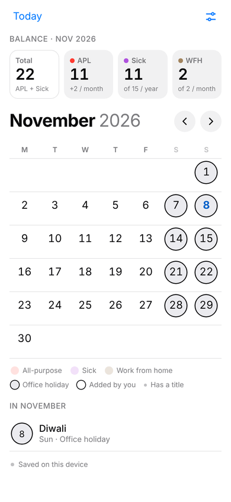
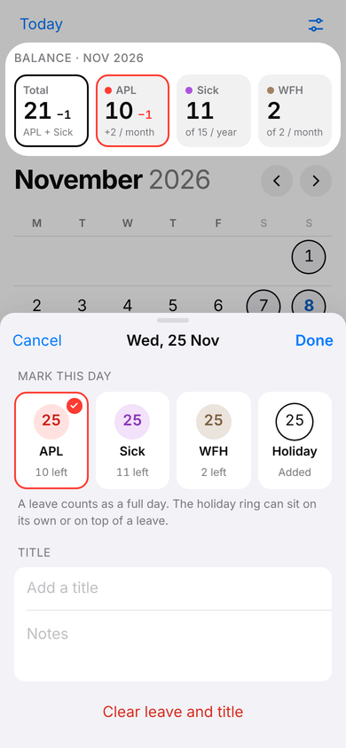
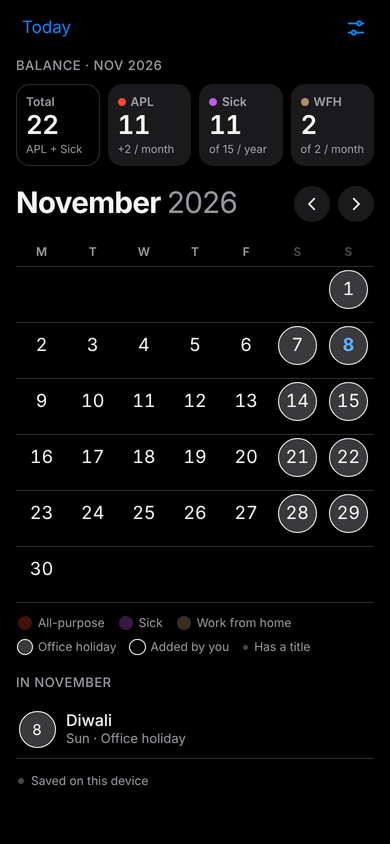
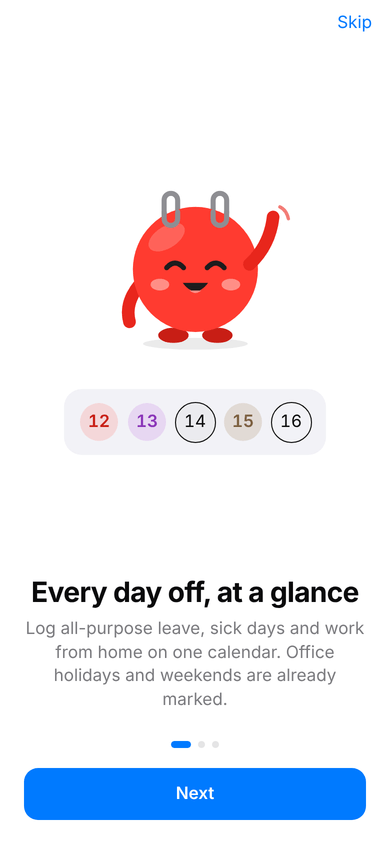
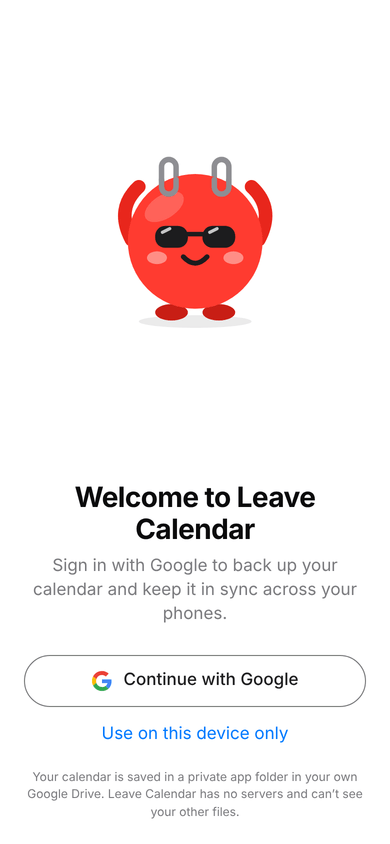
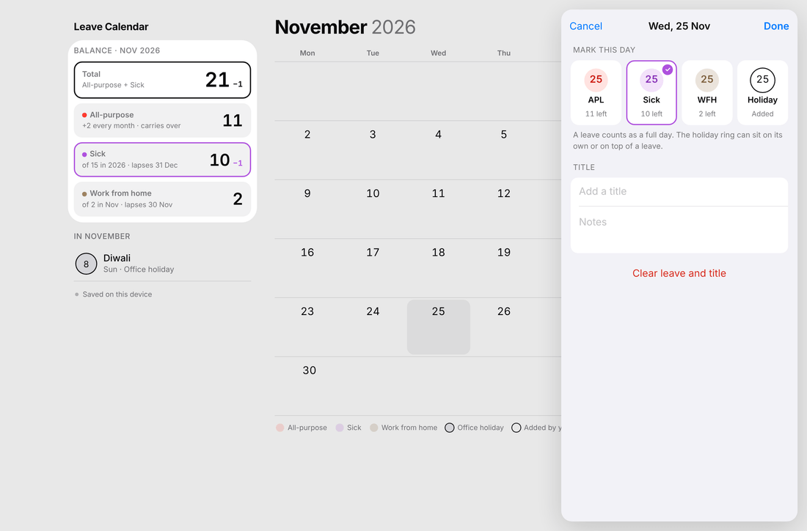

# Leave Calendar

A native iOS and Android app (Expo SDK 58, React Native 0.88, TypeScript) for tracking all-purpose leave,
sick leave and work-from-home days, with balances that work themselves out. It's a port of the
`leave-calendar-reference.html` web app (same layout, colours, copy and leave maths, using `src/rules.ts`
unchanged), plus:

- **Pip**, the mascot, and three onboarding screens
- **Sign in with Google** to back up and sync, or use it on one device without an account
- **Automatic backup, sync and restore** through the user's own Google Drive: no servers and no running costs
- A **SQLite** database on the device (transactions, WAL journal, schema migrations)

| Calendar | Live preview while editing | Dark | Onboarding | Sign in |
|---|---|---|---|---|
|  |  |  |  |  |

Tablets and landscape (≥ 960 pt) get the sidebar layout with sheets as a side panel:


_(Screenshots are from the web preview of the same code.)_

---

## Run it locally

```bash
npm install
```

Google Sign-In and the keyboard handling use native modules that aren't in Expo Go, so use a
**development build** (once per native change), then start Metro:

```bash
npx eas-cli@latest build --profile development --platform android   # or ios / development-simulator
```

```bash
npm start
```

Without a dev build you can still try the UI in a browser. There, data is kept in `localStorage` and Google
sign-in is off:

```bash
npm run web
```

### Checks

```bash
npm run check        # TypeScript (app + tests) and all tests
```

```bash
npx expo lint
```

- `src/rules.test.ts` is your original test file, unchanged, run with Node's type stripping beside `leave-calendar-data.json`.
- `src/data/data.spec.ts` covers the clock, records, merging and the database store.
- `src/sync/sync.spec.ts` simulates several phones syncing through a fake Google Drive: restore on a new phone,
  concurrent edits, clock skew, deletes, offline, newer app versions, and the Drive REST requests.

---

## Google setup (one time, about 15 minutes)

The app only asks for the **`drive.appdata`** scope. It can read and write its own hidden folder in the
user's Drive and nothing else. Google classes this scope as **non-sensitive**, so the app only needs basic
brand verification, not a security assessment.

1. **Google Cloud Console** → create a project (e.g. "Leave Calendar") → *APIs & Services* → **Enable "Google Drive API"**.
2. **Google Auth Platform** (OAuth consent screen):
   - Branding: app name "Leave Calendar", support email, logo (`assets/icon.png`), privacy policy URL (publish `PRIVACY.md`).
   - Data access: add the scope `https://www.googleapis.com/auth/drive.appdata`.
   - Audience: while in *Testing*, add your Google accounts as test users. **Publish to production** before release.
3. **Clients** → create OAuth client IDs:
   - **iOS**: bundle ID `com.adityamaurya.leavecalendar` (see *Store identifiers* below).
   - **Android**: package `com.adityamaurya.leavecalendar` + the **SHA-1** of each signing key. Make one client per key:
     the EAS upload/debug key (`npx eas-cli credentials`) and the **Play App Signing** key (Play Console →
     *Test and release → App integrity*).
   - **Web application** (no redirect URIs needed). Its ID goes in `webClientId`.
4. Put the IDs in EAS environment variables (they're public identifiers, not secrets) for the `development`,
   `preview` and `production` environments:

```bash
npx eas-cli@latest env:create --name EXPO_PUBLIC_GOOGLE_IOS_CLIENT_ID --value 1234-abc.apps.googleusercontent.com --visibility plaintext --environment production --environment preview --environment development
```

```bash
npx eas-cli@latest env:create --name EXPO_PUBLIC_GOOGLE_WEB_CLIENT_ID --value 1234-xyz.apps.googleusercontent.com --visibility plaintext --environment production --environment preview --environment development
```

   For local runs, copy `.env.example` to `.env` and fill in the same values. `app.config.ts` derives the iOS URL
   scheme from the iOS client ID automatically.

---

## Build and release

```bash
npx eas-cli@latest init
```

```bash
npx eas-cli@latest build --profile production --platform all
```

```bash
npx eas-cli@latest submit --platform ios
```

```bash
npx eas-cli@latest submit --platform android
```

Profiles (`eas.json`): `development` (dev client, internal), `development-simulator`, `preview` (internal; APK on Android),
`production` (store builds, auto-incremented build numbers).

### Store identifiers (decide before the first upload; they can't change later)

`app.config.ts` uses `com.adityamaurya.leavecalendar` for both the iOS bundle ID and the Android package.
To use another one, change the default there or build with `APP_ID=com.yourco.leavecalendar`.

### Go-live checklist

- [ ] Google Cloud project set up and the OAuth app **published to production** (above)
- [ ] Privacy policy hosted at a public URL (`PRIVACY.md` is a ready draft), linked in Google, App Store Connect and Play Console
- [ ] App Store privacy label: *Data Not Collected*. Calendar data goes only to the user's own Google Drive; there are no servers, analytics or tracking.
- [ ] Play Console Data safety: no data collected or shared by the developer; data is encrypted in transit (HTTPS to Google)
- [ ] App Review note for Apple: "Google sign-in is optional ('Use on this device only'). It's used only to store
      the user's calendar in their own Google Drive app folder. The app has no accounts or servers of its own."
      This covers guidelines **5.1.1(v)** (apps without account-based features must work without a login) and **4.8**.
- [ ] Release builds tested on a real iPhone and Android phone: sign in, edit on one, see it on the other, reinstall, restore

---

## Your existing data

The app no longer ships with `leave-calendar-data.json` built in. It's a public app now, so every new user
starts with an empty calendar, and your personal days stay out of the store build. To bring yours in once:
**Settings → Saving → Import backup** and pick `leave-calendar-data.json` (e.g. from Files or Google Drive).
After you sign in with Google it's backed up and syncs to your other phones. **Export backup** writes the same
format (`leave-calendar-YYYY-MM-DD.json`) through the share sheet.

---

## How backup, sync and restore work

Design goals: no servers to run or pay for, works offline, no lost edits between phones, simple enough to reason about.

```
 phone A ── SQLite (source of truth) ──┐                         ┌── SQLite ── phone B
                                       ├─► Google Drive app folder (hidden, per user)
                                       │     lc-replica-<A>.json   (written only by A)
                                       │     lc-replica-<B>.json   (written only by B)
```

1. **Local-first.** The device's SQLite database is the source of truth, and the app never waits for the network.
   `src/data/store.ts` turns every change from `rules.ts` into small **records**: one per field of a day
   (`d/2026-11-25/leave`, `…/title`, `…/note`), holiday, repeating holiday, setting or typed balance.
2. **Hybrid logical clock stamps** (`src/data/hlc.ts`). Each changed record gets a stamp that sorts by time and
   never goes backwards, even when phone clocks disagree. Deletes are kept as stamped tombstones so they sync too.
3. **Last-writer-wins merge, per record** (`src/data/records.ts`). Merging is commutative, associative and idempotent,
   so phones can sync in any order, any number of times, after weeks offline, and still end up identical.
   Because days are merged per field, a leave set on one phone and a note added on another both survive.
4. **One file per phone in Google Drive's hidden app folder** (`src/sync/engine.ts`). The Drive v3 API has no
   conditional writes (no ETag / `If-Match` on files), so two phones writing one shared file could lose an update.
   Here each phone writes only its own file and reads everyone's. A sync is:
   list files → download the ones whose MD5 changed → merge → upload your own file if you have something new.
   With nothing new that's a single small request. Each file holds a full merged copy, so any one is a complete backup.
5. **When it syncs** (`src/sync/controller.ts`): right after sign-in, 1.5 s after a change, when the app comes back to
   the foreground, and every 5 min while it's open. Failures retry with backoff (5 s → 5 min); expired sessions,
   missing Drive permission and a full Google storage each get their own message.
6. **Restore** = sign in on the new phone. It downloads and merges every file before showing the calendar.
   Local data from before signing in is merged in, not overwritten.
7. **Safety rails.** A file written by a newer app version is never overwritten (the app asks the user to update).
   Signing out removes the calendar from the device (it stays in Drive), and switching Google accounts asks first,
   so one person's calendar can't merge into another's. **Delete backup** removes the files and revokes access.
   Users can also remove them in Google Drive → Settings → Manage apps → *Delete hidden app data*.

Background reading: [Choose Google Drive API scopes](https://developers.google.com/workspace/drive/api/guides/api-specific-auth),
[Store application-specific data](https://developers.google.com/workspace/drive/api/guides/appdata),
[Drive v3 discovery document](https://www.googleapis.com/discovery/v1/apis/drive/v3/rest) (File has no `etag`),
[Offline-first sync, conflicts and CRDTs](https://www.techinterview.org/post/3233474986/design-offline-first-mobile-app/),
[The secret life of a local-first value](https://marcobambini.substack.com/p/the-secret-life-of-a-local-first).

---

## Project structure

```
app.config.ts           Expo config (ids, icons, splash, plugins, orientation, permissions)
eas.json                EAS build profiles
assets/                 icons + splash, rendered from the mascot SVG by `npm run assets`
src/
  rules.ts              the rules engine (unchanged)          rules.test.ts + leave-calendar-data.json
  App.tsx               providers, theme, boot, onboarding → sign-in → calendar
  core.ts               store + sync singletons, hooks, sign-in/out
  theme.ts              design tokens (light/dark), breakpoints
  data/                 hlc.ts, records.ts, store.ts (pure TS) · db.ts (SQLite) · backup.ts (export/import)
  sync/                 drive.ts, replica.ts, engine.ts (pure TS) · auth.ts (Google) · controller.ts (scheduling)
  calendar/             CalendarScreen, Balance tiles, MonthGrid, MonthList, Day/Balance/Settings sheets, Saving
  onboarding/           mascot.ts (Pip SVG source), Mascot, Onboarding, SignIn, buttons
  ui/                   T (text), DayCircle, Sheet, Toast, controls (switch, segmented, stepper, …), groups, icons
```

## Native behaviour on top of the web app

- Native sheets: drag down or flick to dismiss. On Android, the back gesture or back button closes the sheet.
- The sheet rides above the keyboard frame by frame on both platforms (react-native-keyboard-controller), and the
  focused field scrolls into view.
- Haptics on leave/holiday options and steppers. Reduce Motion skips the slide and fade animations.
- Dynamic Type is capped at 1.3×. VoiceOver and TalkBack labels and states are set throughout.
- The appearance choice also themes native alerts and keyboards. Edge-to-edge system bars.
- Phones are portrait-only; tablets rotate. "Today" is re-read when the app returns to the foreground.

## Known follow-ups

- **Android sign-in SDK.** The free `@react-native-google-signin/google-signin` uses Google's *legacy* Sign-In SDK on
  Android, which Google has deprecated (it's gone from `play-services-auth` 22). It works with the pinned
  21.x, but plan to move to Credential Manager + `AuthorizationClient`. That's either the library's paid
  *Universal Sign In* edition or a small Expo module. All Google calls go through `src/sync/auth.ts`, so it's a one-file swap.
- **Company-specific rules.** The joining date (30 Apr 2026) and the office holiday list are built into `rules.ts`
  for your current employer. Make them settings before opening the app to other companies.
- Old replica files (from reinstalls) are kept forever. They're small; a cleanup pass could delete ones fully
  contained in the current file.
